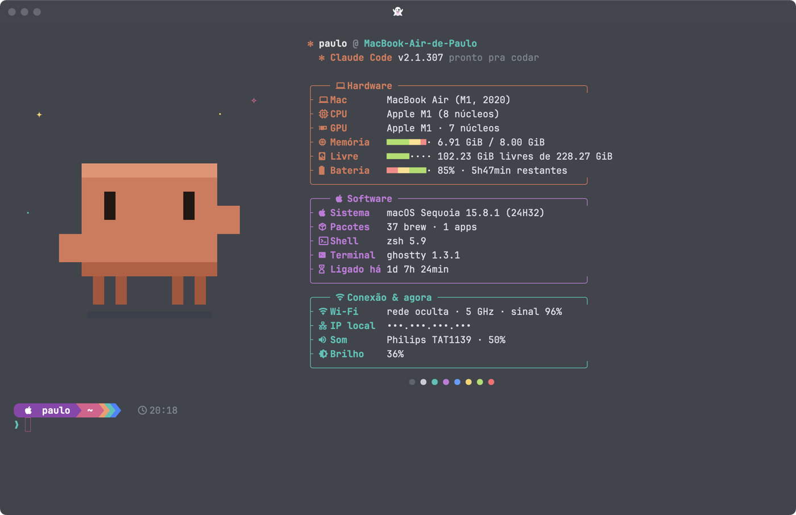
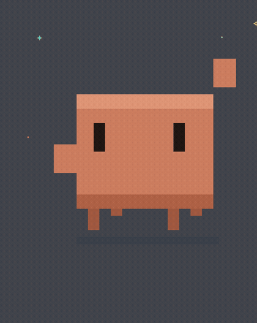
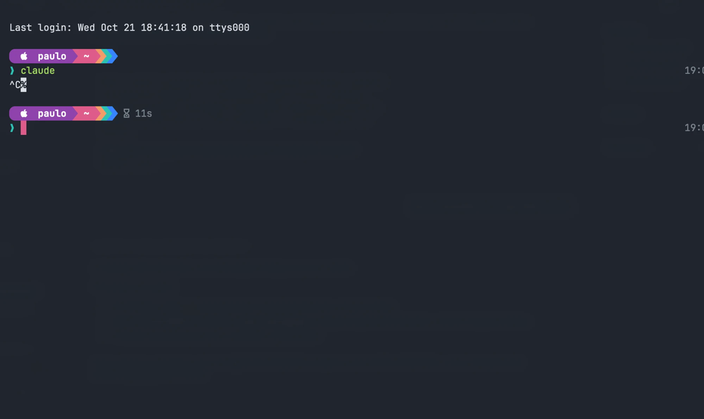
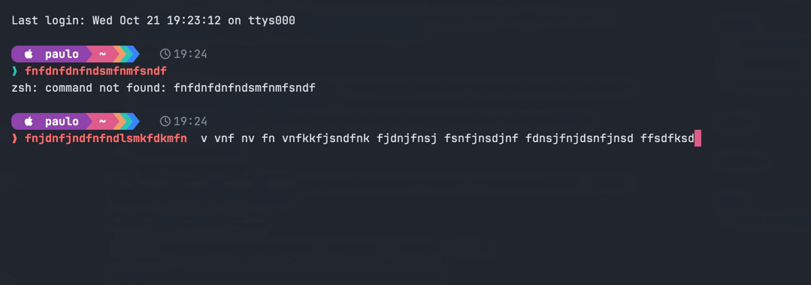

# ✻ Neon Clawd — preset para o Ghostty

Preset completo para o terminal [Ghostty](https://ghostty.org) no macOS: tela de boas-vindas com o Clawd animado, prompt em blocos coloridos, animações a cada tecla, palavras coloridas, som de teclado mecânico e um tema grafite com cores neon.



<p align="center"></p>

## O que vem no pacote

| Recurso | Como funciona |
|---|---|
| **Tela de boas-vindas** | Ao abrir o Ghostty: Clawd animado (balança, anda, pisca e dá tchau) + caixas com hardware, software, Wi-Fi, IP, som, música tocando, disco livre, bateria |
| **Prompt powerline** | Blocos roxo → rosa com setas em degradê, branch do Git, versão de Node/Python/Rust/Go, tempo de comandos lentos e relógio ([Starship](https://starship.rs)) |
| **Animações por tecla** | Enter = feixe roxo→azul + anel · Apagar = faíscas vermelhas · Espaço = ondulação verde-água · Letras = brilho rosa · Saltos = rastro rosa |
| **Palavras coloridas** | O comando fica verde (existe) ou vermelho (não existe); cada palavra seguinte ganha uma cor |
| **Erro bonito** | `command not found` vira uma faixa colorida com dica |
| **`ls` com ícones** | `ls`, `la`, `ll`, `lt` via [eza](https://eza.rocks) |
| **Som de teclado** | Gravações reais de um teclado NK Cream, sons diferentes para tecla, espaço, Enter e apagar |
| **Vidro fosco** | Fundo 80% opaco com desfoque, barra de título com abas |
| **Terminal suspenso** | `Cmd+`` ` abre/fecha um terminal que desce do topo, de qualquer app |




## Instalação

Requisitos: macOS, [Ghostty](https://ghostty.org), [Homebrew](https://brew.sh) e as ferramentas de linha de comando do Xcode (`xcode-select --install`, para compilar o som).

```bash
git clone https://github.com/paulohenriquehto/ghostty-neon-clawd.git
cd ghostty-neon-clawd
zsh install.sh
```

O instalador:
1. instala `starship`, `eza`, `fastfetch`, `zsh-autosuggestions` e `zsh-syntax-highlighting` pelo Homebrew;
2. faz **backup** dos seus arquivos atuais em `~/.config/neon-clawd-backup-<data>/`;
3. copia as configurações, gera os quadros do Clawd e compila o tocador de som;
4. adiciona um bloco marcado `>>> neon-clawd >>>` no fim do seu `~/.zshrc`.

Depois, feche o Ghostty (Cmd+Q) e abra de novo.

### Som em qualquer programa (opcional)

Por padrão o som toca enquanto você digita no prompt. Para tocar também dentro de programas (vim, Claude Code etc.):

```bash
zsh ~/.config/ghostty/keysound/ativar-som-global.sh
```

O macOS vai pedir **Monitoramento de Entrada** para o Ghostty (Ajustes do Sistema → Privacidade e Segurança). O tocador só **ouve** as teclas enquanto o Ghostty está na frente e só toca som: não grava nem envia nada. Para voltar: `zsh ~/.config/ghostty/keysound/ativar-som-global.sh desfazer`.

## Comandos

| Comando | O que faz |
|---|---|
| `welcome` | mostra a tela de boas-vindas de novo |
| `welcome off` / `welcome on` | desliga/liga a tela ao abrir o terminal |
| `WELCOME_PRIVATE=1 welcome` | esconde nome do Wi-Fi e IP (bom para prints e lives) |
| `som off` / `som on` | desliga/liga o som de teclado |
| `som vol 0.3` | volume do som (0.1 a 1.0) |

## Onde fica cada coisa

| Arquivo no repositório | Vai para |
|---|---|
| `ghostty/config.ghostty` | `~/Library/Application Support/com.mitchellh.ghostty/config.ghostty` |
| `ghostty/themes/` (`neon-slate`, `mezzanotte`) | `~/.config/ghostty/themes/` |
| `ghostty/shaders/key_effects.glsl` | `~/.config/ghostty/shaders/` |
| `ghostty/welcome/` (Clawd + boas-vindas) | `~/.config/ghostty/welcome/` |
| `ghostty/keysound/` (som de teclado) | `~/.config/ghostty/keysound/` |
| `zsh/visual.zsh` (cores e erro) | `~/.config/ghostty/zsh-visual.zsh` |
| `fastfetch/config.jsonc` | `~/.config/fastfetch/config.jsonc` |
| `starship/starship.toml` | `~/.config/starship.toml` |
| `zsh/zshrc-snippet.zsh` | adicionado ao fim do `~/.zshrc` |

## Personalizar

- **Transparência:** `background-opacity` (0.0–1.0) e `background-blur` em `config.ghostty`, depois `Cmd+Shift+,`.
- **Tema azul e dourado:** troque `theme = neon-slate` por `theme = mezzanotte`.
- **Animações:** cores e durações no topo de `key_effects.glsl`.
- **Clawd:** edite cores/movimentos em `make_clawd.py` e rode `python3 ~/.config/ghostty/welcome/make_clawd.py`.
- **Sons sintéticos** (sem gravação): `python3 ghostty/keysound/make_sounds.py <pasta>` gera um teclado "thock" por código.

## Créditos

- Sons NK Cream: [Mechvibes](https://github.com/hainguyents13/mechvibes) (MIT, © 2021 Hai Nguyen) — veja `ghostty/keysound/sounds-nk-cream/LICENSE-MECHVIBES`.
- Clawd é o mascote do [Claude Code](https://claude.com/claude-code). Este é um projeto de fã, sem afiliação com a Anthropic; o desenho em pixel art e a animação foram feitos do zero para este preset.
- Fonte JetBrains Mono (embutida no Ghostty), ícones Nerd Font.

## Licença

[MIT](LICENSE) — use, copie, modifique e distribua à vontade.
